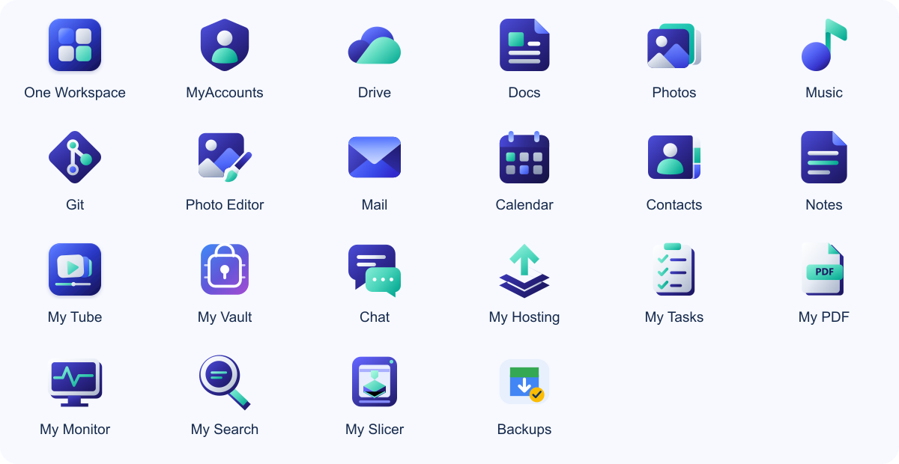

  
  <h1>One Workspace</h1>
  
Your apps and files, together on your own Windows PC.

  
<a href="https://github.com/oneworkspacestudio/one-workspace/releases"><strong>Download for Windows</strong></a> · <a href="#get-started">Get started</a> · <a href="docs/TECHNICAL.md">Technical guide</a>

*An illustrated look at the workspace. Check the download notes for the apps included in each package.*

## A place for your everyday work

Browse files, edit documents, enjoy your photos and music, and move between apps with one account. One Workspace brings them together in a browser, while your files stay on the computer and in the folders you choose.

- **Your files stay yours.** Work with ordinary folders on your own storage.
- **Connected sign-in.** Sign in once with MyAccounts and open connected apps without repeating their sign-in buttons. My Vault keeps its independent master password. [How sign-in works](docs/SIGN-IN.md).
- **Optional backups.** The owner’s built-in Backups app can copy the whole workspace to another local NTFS drive on a schedule. Scheduling starts off. [Backup setup and recovery](docs/BACKUPS.md).
- **Choose your apps.** Advanced setup remembers unchecked apps and handles their dependencies. Workspace updates automatically include newly added default apps.
- **Room to grow.** Add more apps as your needs change.

## Meet your apps

*The current project logos. Open an app repository below for its source, README and downloads.*

<table>
  <thead>
    <tr><th colspan="2">App</th><th>What you can do</th><th>Repository</th></tr>
  </thead>
  <tbody>
    <tr>
      <td align="center" valign="middle" width="64"></td>
      <td valign="middle"><strong>Drive</strong></td>
      <td valign="middle">Browse, upload, organise and share your files.</td>
      <td valign="middle"><a href="https://github.com/oneworkspacestudio/drive">drive</a></td>
    </tr>
    <tr>
      <td align="center" valign="middle" width="64"></td>
      <td valign="middle"><strong>Docs</strong></td>
      <td valign="middle">Create and edit documents, spreadsheets, slides and PDFs.</td>
      <td valign="middle"><a href="https://github.com/oneworkspacestudio/drive">drive</a></td>
    </tr>
    <tr>
      <td align="center" valign="middle" width="64"></td>
      <td valign="middle"><strong>Photos</strong></td>
      <td valign="middle">Browse your pictures and explore folders as albums.</td>
      <td valign="middle"><a href="https://github.com/oneworkspacestudio/drive">drive</a></td>
    </tr>
    <tr>
      <td align="center" valign="middle" width="64"></td>
      <td valign="middle"><strong>Music</strong></td>
      <td valign="middle">Listen to your music collection.</td>
      <td valign="middle"><a href="https://github.com/oneworkspacestudio/Music">Music</a></td>
    </tr>
    <tr>
      <td align="center" valign="middle" width="64"></td>
      <td valign="middle"><strong>Git</strong></td>
      <td valign="middle">Keep code projects organised and collaborate.</td>
      <td valign="middle"><a href="https://github.com/oneworkspacestudio/gitea">gitea</a></td>
    </tr>
    <tr>
      <td align="center" valign="middle" width="64"></td>
      <td valign="middle"><strong>MyAccounts</strong></td>
      <td valign="middle">Manage people, sign-ins and passwords.</td>
      <td valign="middle"><a href="https://github.com/oneworkspacestudio/myaccounts">myaccounts</a></td>
    </tr>
    <tr>
      <td align="center" valign="middle" width="64"></td>
      <td valign="middle"><strong>Photo Editor</strong></td>
      <td valign="middle">Draw and edit images and layers, opening and saving directly in Drive. A standalone Studio.exe is also installed.</td>
      <td valign="middle"><a href="https://github.com/oneworkspacestudio/Photo-Editor">Photo-Editor</a></td>
    </tr>
    <tr>
      <td align="center" valign="middle" width="64"></td>
      <td valign="middle"><strong>Mail</strong></td>
      <td valign="middle">Your inbox, automatic MyAccounts mailboxes and guided hosting setup.</td>
      <td valign="middle"><a href="https://github.com/oneworkspacestudio/mail">mail</a></td>
    </tr>
    <tr>
      <td align="center" valign="middle" width="64"></td>
      <td valign="middle"><strong>Calendar</strong></td>
      <td valign="middle">Events, schedules and calendars with MyAccounts sign-in.</td>
      <td valign="middle"><a href="https://github.com/oneworkspacestudio/calendar">calendar</a></td>
    </tr>
    <tr>
      <td align="center" valign="middle" width="64"></td>
      <td valign="middle"><strong>Contacts</strong></td>
      <td valign="middle">Your address book, sharing Calendar's local service.</td>
      <td valign="middle"><a href="https://github.com/oneworkspacestudio/calendar">calendar</a></td>
    </tr>
    <tr>
      <td align="center" valign="middle" width="64"></td>
      <td valign="middle"><strong>Notes</strong></td>
      <td valign="middle">Private notes and notebooks, with Markdown editing and history.</td>
      <td valign="middle"><a href="https://github.com/oneworkspacestudio/notes">notes</a></td>
    </tr>
    <tr>
      <td align="center" valign="middle" width="64"></td>
      <td valign="middle"><strong>My Tube</strong></td>
      <td valign="middle">Upload and watch videos, create channels and playlists, and follow your community.</td>
      <td valign="middle"><a href="https://github.com/oneworkspacestudio/my-tube">my-tube</a></td>
    </tr>
    <tr>
      <td align="center" valign="middle" width="64"></td>
      <td valign="middle"><strong>Chat</strong></td>
      <td valign="middle">Messages, groups and attachments with MyAccounts sign-in, local stickers and offline continuity.</td>
      <td valign="middle"><a href="https://github.com/oneworkspacestudio/chat">chat</a></td>
    </tr>
    <tr>
      <td align="center" valign="middle" width="64"></td>
      <td valign="middle"><strong>My Vault</strong></td>
      <td valign="middle">An independent password vault with compatible clients, encrypted backups and portable recovery.</td>
      <td valign="middle"><a href="https://github.com/oneworkspacestudio/my-vault">my-vault</a></td>
    </tr>
    <tr>
      <td align="center" valign="middle" width="64"></td>
      <td valign="middle"><strong>My Hosting</strong></td>
      <td valign="middle">Deploy websites and Node apps from GitHub or ZIP with previews and rollback.</td>
      <td valign="middle"><a href="https://github.com/oneworkspacestudio/my-hosting">my-hosting</a></td>
    </tr>
    <tr>
      <td align="center" valign="middle" width="64"></td>
      <td valign="middle"><strong>My Tasks</strong></td>
      <td valign="middle">Private and shared lists, recurring tasks, reminders and Calendar/Notes links.</td>
      <td valign="middle"><a href="https://github.com/oneworkspacestudio/my-tasks">my-tasks</a></td>
    </tr>
    <tr>
      <td align="center" valign="middle" width="64"></td>
      <td valign="middle"><strong>My PDF</strong></td>
      <td valign="middle">PDF viewing, annotations and copy-oriented tools; automatic Drive saves with status and retry.</td>
      <td valign="middle"><a href="https://github.com/oneworkspacestudio/my-pdf">my-pdf</a></td>
    </tr>
    <tr>
      <td align="center" valign="middle" width="64"></td>
      <td valign="middle"><strong>My Monitor</strong></td>
      <td valign="middle">Private service health, uptime history, incidents and opt-in public status.</td>
      <td valign="middle"><a href="https://github.com/oneworkspacestudio/my-monitor">my-monitor</a></td>
    </tr>
    <tr>
      <td align="center" valign="middle" width="64"></td>
      <td valign="middle"><strong>My Search</strong></td>
      <td valign="middle">Permission-aware search across connected apps; Vault contents are excluded.</td>
      <td valign="middle"><a href="https://github.com/oneworkspacestudio/my-search">my-search</a></td>
    </tr>
    <tr>
      <td align="center" valign="middle" width="64"></td>
      <td valign="middle"><strong>Backups</strong></td>
      <td valign="middle">Optional scheduled snapshots of accounts, app data, programs and ordinary files. Owner access only; off by default.</td>
      <td valign="middle">Built into One Workspace</td>
    </tr>
    <tr>
      <td align="center" valign="middle" width="64"></td>
      <td valign="middle"><strong>My Slicer</strong></td>
      <td valign="middle">Prepare STL and supported Bambu 3MF, slice with the native engine, preview real layers and print locally to A1 / A1 mini. <a href="docs/MY-SLICER.md">Setup and acceptance limits</a>.</td>
      <td valign="middle"><a href="https://github.com/oneworkspacestudio/my-slicer">my-slicer</a></td>
    </tr>
      <tr>
      <td align="center" valign="middle" width="64"></td>
      <td valign="middle"><strong>My Social</strong></td>
      <td valign="middle">Capture, compose and share protected photos, Stories and Reels. <a href="docs/MY-SOCIAL.md">Preview features and limits</a>.</td>
      <td valign="middle"><a href="https://github.com/oneworkspacestudio/my-social">my-social</a></td>
    </tr>
</tbody>
</table>

**Preview 50 adds [My Clips](docs/MY-CLIPS.md)**: an original short-video app, private Drive originals, adaptive HLS, creator tools, recommendations and a signed Android client. Existing app pins are preserved. This is a first preview with documented parity and device limits.

**Preview 49 improves [Chat continuity](docs/CHAT.md#offline-continuity-in-chat10).**
Previously opened Chat pages load during outages, messages stay in a durable
queue, and existing one-to-one chats can reconnect directly while the server is
down. Includes the shared navigation styling fix and all 21 apps, including
Social2 from Preview48. Built locally without GitHub Actions.

**Preview 41 improves My Tube playback.** Automatic verified video tools, bounded adaptive qualities and conservative Auto playback reduce the bandwidth needed for remote watching. Existing originals remain unchanged. [Streaming details](docs/MY-TUBE-STREAMING.md).

**Preview 40 fixes PDF storage in Drive.** New uploads and processed PDF copies save automatically into **Drive / My PDF**, with per-file status, numbered duplicates and retries. Existing library documents have a Save to Drive action. See [saving details and limits](docs/PDF-DRIVE-SAVE.md).

**Preview 47 adds [My Social](docs/MY-SOCIAL.md)** with MyAccounts sign-in, guarded My Photos originals and the shared Workspace launcher. Full Instagram parity remains unfinished.

**Preview 37 adds My Tasks, My PDF, My Monitor and My Search.** New default apps are installed during Workspace updates; explicit opt-outs are preserved. All four have native Windows downloads, MyAccounts sign-in, matching branding and encrypted recovery. See [delivery and tested limits](docs/FOUR-APPS-DELIVERY.md).

**Preview 36 adds My Hosting.** Deploy trusted static sites, Node/Express and
tested Next/Nuxt builds with real logs, previews, rollback, encrypted backups and
MyAccounts shared sign-in. Managed Cloudflare connections publish flat site
addresses without router setup. [Setup, tests and limits](docs/MY-HOSTING.md).

**Preview 43 upgrades Chat integration.** Chat opens on its own hostname with the same MyAccounts identity, installed-app switcher, synchronized chat lists, durable drafts and offline retry. New manager compatibility checks protect app updates. This is an incomplete WhatsApp-parity candidate; application encryption, full social features, calls and native clients remain unfinished. [Changes, checks and limits](docs/CHAT.md).

**[Preview 35 fixes Chat discovery and messaging](https://github.com/oneworkspacestudio/one-workspace/releases/tag/v0.3.0-preview.35).** MyAccounts members become searchable automatically, including before their first Chat login. Find by name, username, verified email or account ID; open native Chat IDs and QR links. Browser checks covered two-way direct/group messages, attachments and disabled-account access in a separate tester installation. [Chat checks and limits](https://github.com/oneworkspacestudio/chat/blob/master/docs/workspace/ACCEPTANCE.md).

**[Preview 34 adds Chat](https://github.com/oneworkspacestudio/one-workspace/releases/tag/v0.3.0-preview.34).** A portable Tinode-based messenger with One Workspace styling, MyAccounts sign-in and its own protected message and attachment storage. [Chat guide](docs/CHAT.md).

**[Preview 32 connects My Vault automatically](https://github.com/oneworkspacestudio/one-workspace/releases/tag/v0.3.0-preview.32).** Managed Cloudflare hosting provides a separate permanent Vault address and its sign-in callback, retained across updates.

**Clear update completion.** Progress bars appear while an operation is running. Finished updates show a static completion summary and duration, with their completed steps and activity details. [Update guide](docs/UPDATES.md#follow-update-progress).

Preview 30 added download, backup, verification, installation and app startup progress with a checklist, speed and approximate stage time remaining. Small notices use matching verified release files when available, avoiding a complete bundle download.

Preview 29 fixed app sign-in and Windows update restart failures. Connected apps reuse your existing session, including Music when an older offline cache is present. Updates check that Workspace can launch before stopping apps and give clearer recovery guidance. All twelve entries in the existing installation opened without another login during the browser review. [Checks and remaining limits](docs/SIGN-IN.md#recorded-local-review-17-october-2026).

Preview 28 introduced Backups, app selection and per-app runtime storage. Open the owner-only Backups tile to choose a local NTFS destination and interval. Scheduling starts off; scheduled backup/restore acceptance remains pending. [Backup setup and limits](docs/BACKUPS.md).

The organization build includes all currently released apps above, with exact
release URLs and checksums recorded in the package. [App sources and installation](docs/ORG-APPS.md).
Notes is included from its [organization release](https://github.com/oneworkspacestudio/notes/releases).
My Tube is installed with the package from its [organization release](https://github.com/oneworkspacestudio/my-tube/releases), with MyAccounts sign-in, private video storage and My Drive import/export. FFmpeg/FFprobe remain optional separate helpers for broader codecs and HLS.
My Vault automatically gets its own permanent HTTPS address when you use managed Cloudflare hosting. Its DNS, tunnel route and MyAccounts callback are handled by Workspace; updates keep the same link. My Vault uses optional MyAccounts sign-in on that separate secure address. An active MyAccounts session skips another account sign-in; vault encryption still has its own unlock. Independent sign-in and recovery work without MyAccounts or Workspace. [Vault installation, hosting and recovery](docs/MY-VAULT.md).

The Preview 34 bundle adds Chat to the thirteen existing apps, including
[My Vault 0.2.0 RC3](https://github.com/oneworkspacestudio/my-vault/releases/tag/v0.2.0-rc.3).
My Vault keeps independent password access and encrypted recovery tools.
Local recovery uses owner-approved localhost certificate trust; its remote address uses trusted HTTPS.
[Recorded sign-in checks](docs/SIGN-IN.md#recorded-local-review-17-october-2026).

**My Vault is a preview:** do not store important credentials until its remaining client, clean-computer and security acceptance checks are complete. [Recorded checks and limitations](https://github.com/oneworkspacestudio/my-vault/blob/main/docs/acceptance.json).
Calendar and Contacts use a shared local service. Hosting-capable Mail keeps its
existing private engine and mailboxes until an explicit supported migration.
[Shared-service integration](docs/SHARED-SERVICES.md).

Included apps vary by download. The [release notes](https://github.com/oneworkspacestudio/one-workspace/releases) show what is available now.

## Get started

You need a **64-bit Windows PC** and at least **4 GB of free space**, plus room for your files. See the [storage requirements](docs/TECHNICAL.md#requirements-and-storage) before choosing your installation folders.

1. **Download the installer.** Open [Downloads](https://github.com/oneworkspacestudio/one-workspace/releases) and choose `WorkspaceSetup-windows-amd64.exe`.
2. **Make it yours.** Run the setup wizard and enter your name, email address and a password.
3. **Choose one folder.** Workspace organises apps, protected per-app private data and ordinary files inside it. Expand **Advanced: choose your apps** to omit apps. Choose local access or connect your domain with Cloudflare.
4. **Install the latest apps.** Setup downloads the newest published Workspace bundle from GitHub, verifies its checksums, and shows progress. Launch Workspace and sign in.

Your computer needs to stay on while you use the apps. Access through your own web address is optional; the [online setup guide](docs/TECHNICAL.md#local-and-public-addresses) explains what is needed.

## Keep your installation up to date

The owner can open **Updates and backups** from Workspace administration to check
Workspace and its apps, choose compatible releases and update with verified backups
and automatic rollback. Existing accounts, app data, files and storage locations
are retained. After a successful update, [automatic cleanup](docs/UPDATE-CLEANUP.md)
keeps the latest verified rollback and removes older automatic update copies and
owned temporary update folders. Scheduled backups remain separate. The update
window runs locally on your Windows PC.

For an older installation, download the newest installer and choose **Already have
One Workspace?** on its first screen. [Update, backup and recovery guide](docs/UPDATES.md).

Take a look at the setup wizard

> **Currently in preview.** One Workspace is still being developed. Keep backups of important files and read the download notes before installing or changing an existing workspace.

The October 15 bundle includes the updated app icons and fixes, with current
limitations recorded in the release notes. Music uses its previous published
version while Microsoft analyses a Defender detection in its newer build.
[Release status and limitations](docs/RELEASE-STATUS.md).

### Keeping new installs current

Normal installation checks the public GitHub releases each time and downloads the
newest published Workspace application bundle, including preview releases. Each
bundle declares the versions of its apps as a compatible set. An installer you
saved earlier will therefore install the latest published bundle. Unreleased Git
commits are not installed. Setup stops with a retry message if GitHub or checksum
verification fails; it does not silently install the old embedded versions.

Setup also checks [Mail's organization releases](https://github.com/oneworkspacestudio/mail/releases)
independently, and installs the newest published Mail executable with a supported
Workspace compatibility manifest. It verifies GitHub's SHA256 and size before
installation and records the exact Mail version and release source. An invalid,
unavailable or incompatible Mail release stops online installation with guidance.
Download an updated installer if a future Mail integration version is unsupported.

The complete Calendar/Contacts bundle requires installer integration2. Setup17
or earlier stops before installing this bundle and asks for the current installer.
Download the current installer once to move to this application set.

For an intentional offline installation, run
`WorkspaceSetup-windows-amd64.exe --offline`. This uses the versions bundled with
that installer. Existing installations are not automatically upgraded by this
new-install behavior. Mail hosting checks incoming SMTP connectivity separately
and shows guidance for router, Windows firewall or ISP restrictions.

## A few useful things to know

### Where are my files kept?

In the folders you choose on your own computer. They stay as ordinary files that you can access outside Workspace too.

### Can I invite other people?

Yes. Use **Manage accounts** to add people and reset passwords. The starting Drive folder is shared, so review who can access it before inviting others. [Account and sharing details](docs/TECHNICAL.md#accounts-and-administration).

### Do I need an email service?

No. You can create accounts and reset passwords without one. Email verification and password-recovery emails are optional features you can set up later.

### Can I add more apps?

Yes. Workspace can be extended with additional apps. Connecting a new app currently takes some configuration; see [adding apps](docs/TECHNICAL.md#add-another-app).

## Help and further reading

| Looking for… | Start here |
| --- | --- |
| A download or what changed | [Downloads and release notes](https://github.com/oneworkspacestudio/one-workspace/releases) |
| Setup, online access or backups | [Technical guide](docs/TECHNICAL.md) |
| App consistency, Drive workflows and current gaps | [Ecosystem review and local fixes](docs/ECOSYSTEM-REVIEW.md) |
| A problem to report | [Report an issue](https://github.com/oneworkspacestudio/one-workspace/issues) |
| Licensing and component information | [Licenses and sources](docs/COMPONENTS.md) |
