

  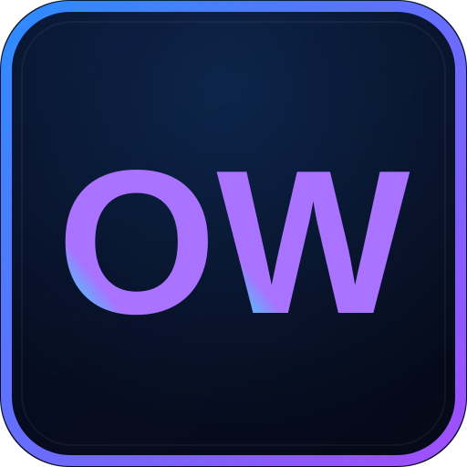
  <h1>One Workspace</h1>
  
Your apps and files, together on your own Windows PC.

  
<a href="https://github.com/oneworkspacestudio/one-workspace/releases"><strong>Download for Windows</strong></a> · <a href="#get-started">Get started</a> · <a href="#help">Get help</a>

<!-- app-overview:start -->
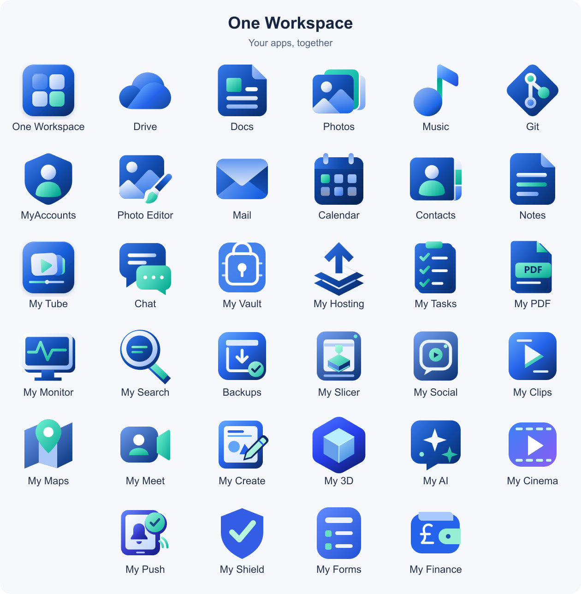
<!-- app-overview:end -->

## A place for your everyday work

Browse files, edit documents, enjoy your photos and music, and keep in touch. One Workspace brings your apps together in a browser, while your files stay on your own computer.

- **Your files stay yours.** Choose where to keep them on your own storage.
- **One account, connected apps.** Sign in once and move between your apps. My Vault keeps a separate master password.
- **Choose what you need.** Select the apps you want during setup and add more later.
- **Keep a copy of your work.** Use the built-in Backups app to save your workspace. [Set up backups](docs/BACKUPS.md).

## Meet your apps

Choose an app name to learn more. The full collection is listed below, including the Workspace hub and the built-in Backups tool.

<!-- app-directory:start -->
<table>
  <thead><tr><th colspan="2">App</th><th>What you can do</th></tr></thead>
  <tbody>
    <tr>
      <td align="center" width="56"></td>
      <td><a href="https://github.com/oneworkspacestudio/one-workspace"><strong>One Workspace</strong></a></td>
      <td>Open your apps and manage your workspace in one place.</td>
    </tr>
    <tr>
      <td align="center" width="56">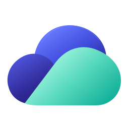</td>
      <td><a href="https://github.com/oneworkspacestudio/drive"><strong>Drive</strong></a></td>
      <td>Browse, upload, organise and share your files.</td>
    </tr>
    <tr>
      <td align="center" width="56"></td>
      <td><a href="https://github.com/oneworkspacestudio/drive"><strong>Docs</strong></a></td>
      <td>Create and edit documents, spreadsheets and presentations.</td>
    </tr>
    <tr>
      <td align="center" width="56">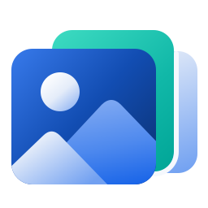</td>
      <td><a href="https://github.com/oneworkspacestudio/drive"><strong>Photos</strong></a></td>
      <td>Browse your pictures and explore folders as albums.</td>
    </tr>
    <tr>
      <td align="center" width="56"></td>
      <td><a href="https://github.com/oneworkspacestudio/Music"><strong>Music</strong></a></td>
      <td>Listen to your own music collection.</td>
    </tr>
    <tr>
      <td align="center" width="56">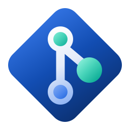</td>
      <td><a href="https://github.com/oneworkspacestudio/gitea"><strong>Git</strong></a></td>
      <td>Keep code projects organised and work on them together.</td>
    </tr>
    <tr>
      <td align="center" width="56">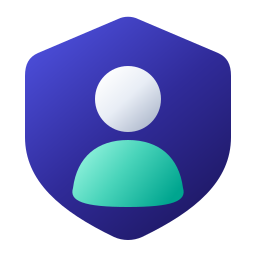</td>
      <td><a href="https://github.com/oneworkspacestudio/myaccounts"><strong>MyAccounts</strong></a></td>
      <td>Manage your account and the people who can sign in.</td>
    </tr>
    <tr>
      <td align="center" width="56">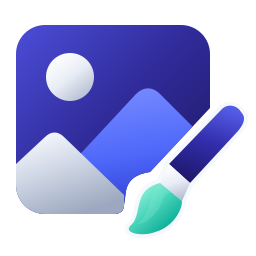</td>
      <td><a href="https://github.com/oneworkspacestudio/Photo-Editor"><strong>Photo Editor</strong></a></td>
      <td>Crop, draw and edit images.</td>
    </tr>
    <tr>
      <td align="center" width="56"></td>
      <td><a href="https://github.com/oneworkspacestudio/mail"><strong>Mail</strong></a></td>
      <td>Read and send email from your workspace.</td>
    </tr>
    <tr>
      <td align="center" width="56"></td>
      <td><a href="https://github.com/oneworkspacestudio/calendar"><strong>Calendar</strong></a></td>
      <td>Plan events and keep track of your schedule.</td>
    </tr>
    <tr>
      <td align="center" width="56">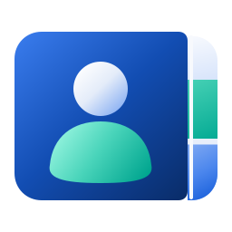</td>
      <td><a href="https://github.com/oneworkspacestudio/calendar"><strong>Contacts</strong></a></td>
      <td>Keep names, email addresses and phone numbers together.</td>
    </tr>
    <tr>
      <td align="center" width="56">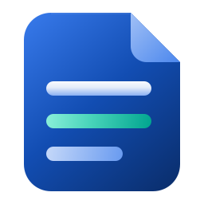</td>
      <td><a href="https://github.com/oneworkspacestudio/notes"><strong>Notes</strong></a></td>
      <td>Write notes and organise them into notebooks.</td>
    </tr>
    <tr>
      <td align="center" width="56"></td>
      <td><a href="https://github.com/oneworkspacestudio/my-tube"><strong>My Tube</strong></a></td>
      <td>Upload and watch videos, create channels and organise playlists.</td>
    </tr>
    <tr>
      <td align="center" width="56"></td>
      <td><a href="https://github.com/oneworkspacestudio/chat"><strong>Chat</strong></a></td>
      <td>Send messages, share files and chat in groups.</td>
    </tr>
    <tr>
      <td align="center" width="56">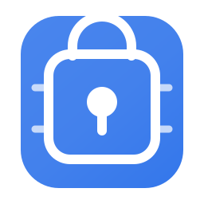</td>
      <td><a href="https://github.com/oneworkspacestudio/my-vault"><strong>My Vault</strong></a></td>
      <td>Keep your passwords in a protected vault.</td>
    </tr>
    <tr>
      <td align="center" width="56"></td>
      <td><a href="https://github.com/oneworkspacestudio/my-hosting"><strong>My Hosting</strong></a></td>
      <td>Publish and manage your websites.</td>
    </tr>
    <tr>
      <td align="center" width="56"></td>
      <td><a href="https://github.com/oneworkspacestudio/my-tasks"><strong>My Tasks</strong></a></td>
      <td>Organise to-do lists, shared tasks and reminders.</td>
    </tr>
    <tr>
      <td align="center" width="56"></td>
      <td><a href="https://github.com/oneworkspacestudio/my-pdf"><strong>My PDF</strong></a></td>
      <td>Read, annotate and organise PDF documents.</td>
    </tr>
    <tr>
      <td align="center" width="56">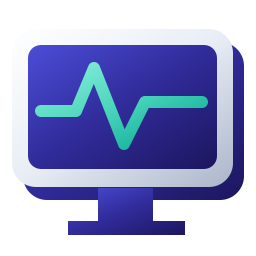</td>
      <td><a href="https://github.com/oneworkspacestudio/my-monitor"><strong>My Monitor</strong></a></td>
      <td>Check whether your apps and websites are running.</td>
    </tr>
    <tr>
      <td align="center" width="56"></td>
      <td><a href="https://github.com/oneworkspacestudio/my-search"><strong>My Search</strong></a></td>
      <td>Find things across your connected apps.</td>
    </tr>
    <tr>
      <td align="center" width="56">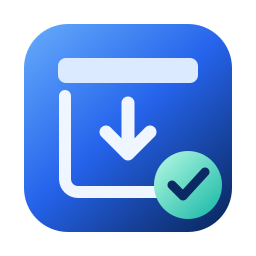</td>
      <td><a href="docs/BACKUPS.md"><strong>Backups</strong></a></td>
      <td>Save copies of your workspace so you can recover your work.</td>
    </tr>
    <tr>
      <td align="center" width="56">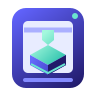</td>
      <td><a href="https://github.com/oneworkspacestudio/my-slicer"><strong>My Slicer</strong></a></td>
      <td>Prepare 3D models for supported printers.</td>
    </tr>
    <tr>
      <td align="center" width="56"></td>
      <td><a href="https://github.com/oneworkspacestudio/my-social"><strong>My Social</strong></a></td>
      <td>Share photos, stories and reels.</td>
    </tr>
    <tr>
      <td align="center" width="56"></td>
      <td><a href="https://github.com/oneworkspacestudio/my-clips"><strong>My Clips</strong></a></td>
      <td>Create, share and discover short videos.</td>
    </tr>
    <tr>
      <td align="center" width="56"></td>
      <td><a href="https://github.com/oneworkspacestudio/my-maps"><strong>My Maps</strong></a></td>
      <td>Explore maps, save places and plan routes.</td>
    </tr>
    <tr>
      <td align="center" width="56"></td>
      <td><a href="https://github.com/oneworkspacestudio/my-meet"><strong>My Meet</strong></a></td>
      <td>Host video meetings, share your screen and chat.</td>
    </tr>
    <tr>
      <td align="center" width="56">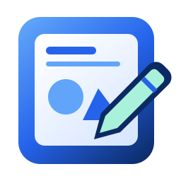</td>
      <td><a href="https://github.com/oneworkspacestudio/my-create"><strong>My Create</strong></a></td>
      <td>Create designs and edit imported text, shapes, pictures and pages.</td>
    </tr>
    <tr>
      <td align="center" width="56"></td>
      <td><a href="https://github.com/oneworkspacestudio/my-3d"><strong>My 3D</strong></a></td>
      <td>Build 3D models from shapes and dimensioned profiles, then export for printing.</td>
    </tr>
    <tr>
      <td align="center" width="56"></td>
      <td><a href="https://github.com/oneworkspacestudio/my-ai"><strong>My AI</strong></a></td>
      <td>Chat with AI models and build with your code projects.</td>
    </tr>
    <tr>
      <td align="center" width="56"></td>
      <td><a href="https://github.com/oneworkspacestudio/my-cinema"><strong>My Cinema</strong></a></td>
      <td>Watch your movies and series with private family profiles.</td>
    </tr>
    <tr>
      <td align="center" width="56">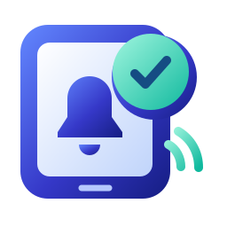</td>
      <td><a href="https://github.com/oneworkspacestudio/my-push"><strong>My Push</strong></a></td>
      <td>Deliver private notifications to your linked phones.</td>
    </tr>
    <tr>
      <td align="center" width="56"></td>
      <td><a href="https://github.com/oneworkspacestudio/my-shield"><strong>My Shield</strong></a></td>
      <td>Review security signals and coverage for this Workspace.</td>
    </tr>
    <tr>
      <td align="center" width="56"></td>
      <td><a href="https://github.com/oneworkspacestudio/my-forms"><strong>My Forms</strong></a></td>
      <td>Create forms and quizzes, collect responses and keep them in My Drive.</td>
    </tr>
    <tr>
      <td align="center" width="56"></td>
      <td><a href="https://github.com/oneworkspacestudio/my-finance"><strong>My Finance</strong></a></td>
      <td>Plan household budgets, track spending and import bank statements.</td>
    </tr>
  </tbody>
</table>
<!-- app-directory:end -->

## Get started

You need a 64-bit Windows PC and room for your apps and files. [Check computer and storage requirements](docs/TECHNICAL.md#requirements-and-storage).

1. **Download the Windows installer** from the [downloads page](https://github.com/oneworkspacestudio/one-workspace/releases).
2. **Create your account.** Setup guides you through your first sign-in.
3. **Choose your folder and apps.** Pick where to keep your workspace and select the apps you want.
4. **Open Workspace.** Finish setup, sign in and choose an app.

Keep the Windows computer switched on while you use its apps. You can use Workspace on that computer or set up your own web address to reach it from other devices. [Setup and online access](docs/TECHNICAL.md).

## Android companion

Apps are organised into **General**, **Administration** and **Development**.
New installations select General and Administration by default. Git, Hosting and My AI
are optional Development apps; choose them in **Advanced: choose your apps**.
Updates keep the apps you already selected.

The [Android app](android/README.md) opens the apps on your Workspace with the
same MyAccounts sign-in. Download the signed APK from the
[Android download](https://github.com/oneworkspacestudio/one-workspace/releases/download/v0.3.0-preview.96/OneWorkspace-Android-0.1.0-preview.6.apk).
Enter your remote Workspace address once; Chat is found automatically, or you can
choose a separate Chat server. Your addresses and valid sign-in are remembered.
It includes a saved app launcher and native Chat notification/background integration. Alerts require the
matching Chat server update and the self hosted My Push app. No Firebase account
is needed for this route. [Phone support and current limits](android/README.md).

## Keep your workspace up to date

Open **Updates and backups** from Workspace administration to check for updates. Your accounts, files and chosen storage folders are kept when you update. Keep a backup of important work and check the download notes before installing.

For an older installation, open the latest installer and choose **Already have One Workspace?** [Update and recovery help](docs/UPDATES.md).

## A few useful things to know

### Where are my files kept?

On your own computer, in the folders you choose. Files you keep in Drive remain ordinary files that you can open outside Workspace too.

### Can I invite other people?

Yes. Use **Manage accounts** to add people. The starting Drive folder is shared, so check who should have access before inviting others. [Accounts and sharing](docs/TECHNICAL.md#accounts-and-administration).

### Do I need an email service?

No. You can create accounts and reset passwords without one. You can set up email verification and password-recovery emails later.

### Can I use it on my phone?

You can open your workspace in your phone's browser once its address is reachable. Keep the Windows computer running. Some apps also offer their own downloads on their app pages.

## Help

| Looking for | Start here |
| --- | --- |
| Downloads and what changed | [Downloads and release notes](https://github.com/oneworkspacestudio/one-workspace/releases) |
| Setup and online access | [Setup guide](docs/TECHNICAL.md) |
| Backups and recovery | [Backup guide](docs/BACKUPS.md) |
| A problem to report | [Report an issue](https://github.com/oneworkspacestudio/one-workspace/issues) |
| Detailed app information | [App guides and current availability](docs/RELEASE-STATUS.md) |
| Licenses and credits | [Licenses and sources](docs/COMPONENTS.md) |
