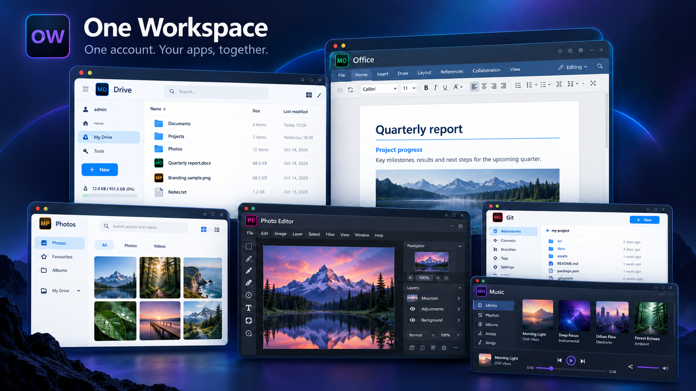

#  One Workspace

Your self-hosted apps, connected by one MyAccounts login. Install the core suite with one Windows EXE, keep files on your own storage, and add more apps as your workspace grows.

[Download Windows installer](https://github.com/fahimc/one-workspace/releases) · [Setup guide](#install) · [Add an app](docs/ADDING-APPS.md) · [Source and licenses](docs/COMPONENTS.md)



*Illustrated product overview. Check the release notes for included apps; the guides below include actual interface captures and current preview limits.*

## Meet the apps

| App | What you can do |
| --- | --- |
| **MyAccounts** | Sign in, manage people and reset passwords. |
|  **Drive** | Browse, upload, share and organise files with [My Drive](https://github.com/fahimc/filebrowser). |
|  **Office** | Edit documents, sheets, slides and PDFs inside Drive. [Office guide](https://github.com/fahimc/filebrowser/blob/master/OFFICE.md). |
|  **Photos** | Explore your existing folders as a photo library. [Photos guide](https://github.com/fahimc/filebrowser/blob/master/PHOTOS.md). |
|  **Git** | Host repositories and collaborate with [My Git](https://github.com/fahimc/gitea). |
|  **Music** | Play your library from the shared Music folder with [My Music](https://github.com/fahimc/swingmusic). |
|  **Photo&nbsp;Editor** | Edit images with layers, drawing tools and filters in [Studio](https://github.com/fahimc/miniPaint). |

Downloadable previews list their included apps in the release notes. Photo Editor is a separate integration. The Mail-enabled installer and newer setup screens described below are local development previews; published EXEs have not been replaced. See [component coverage](docs/GIT-MUSIC.md) for the existing package details.

**Optional Mail:** the [Stalwart-based Mail app](https://github.com/fahimc/stalwart/tree/main/workspace-mail) adds webmail and MyAccounts sign-in. Its local hosting preview adds automatic domain setup with advanced options; see the [Mail integration guide](docs/MAIL.md).

## Install

1. Download `WorkspaceSetup-windows-amd64.exe` from [One Workspace releases](https://github.com/fahimc/one-workspace/releases) and check its included apps and release notes.
2. Run it and enter your name, email address and a password. No SMTP account is required.
3. In the published installer, choose folders for programs, private data and your files. The private-data folder needs a local **NTFS** drive.
4. Choose local access, your existing HTTPS proxy or a dedicated Cloudflare Tunnel.
5. Install and launch. Open Workspace, sign in and choose an app.

The installer includes the app binaries, editor assets and optional Cloudflare connector. Installing does not require Go, Node.js, Python, Docker or a separate Office server. Allow at least 2 GB for programs/setup plus room for your files. The current packages are unsigned Windows x64 previews.

<details>
<summary>See the setup wizard</summary>


</details>

<details>
<summary>Newer local setup preview: one folder, domain connection and startup progress</summary>

These screens are from local development builds; this documentation update does not publish their source changes or a new installer.

- Choose **one parent folder on a local NTFS drive**. Workspace validates it and organises apps, private settings and files beneath it.
- Choose **Host on my domain**, enter your domain and select **Connect Cloudflare**. The preview discovers the account/zone and chooses available web addresses.
- Follow the startup checklist to see completed checks, the current step and any blocker. An existing installation can reopen its progress screen.


[Domain setup, progress screens and hosting requirements](docs/HOSTING.md).

</details>

Files remain ordinary files in your chosen folder. The initial `My Drive` is a shared source, rather than an automatic private home per person. Configure FileBrowser scopes and permissions before giving different people access to different files. These applications use your own hosting and storage; no Google service is required.

## Accounts and administration
The wizard creates a Workspace owner in the ordinary `myaccounts` organization.
Sign in to the portal, then use **Manage accounts** to add/edit/remove users and
reset passwords. Email delivery is disabled initially; administrators can reset
passwords without email. Configure an email service separately in MyAccounts if
you want verification emails or self-service recovery.

Apps share an identity. An existing MyAccounts session is reused when opening
Drive's **Sign in with MyAccounts** link; Docs and Photos reuse Drive's session.
Each app retains its own session. Portal sign-out clears the portal session;
sign out of Drive and Accounts as well on shared computers. Immediate global
session revocation across all apps is not implemented in this preview.

## Local and public addresses
Default local addresses are `http://localhost:8990` for Workspace and
`http://localhost:8991` for Accounts. Drive is under `/drive/`, Docs opens the
Documents folder, and standalone Photos is at `/photos-app/` on Workspace.
Web apps bind to loopback. The local automatic Mail hosting preview additionally enables a public SMTP listener on TCP 25; Windows/network access still needs to allow it.

For public setup, enter two stable HTTPS addresses, such as
`https://workspace.example.com` and `https://login.example.com`. Existing proxy
mode must route them to the Workspace base port and the next port respectively,
preserving the external Host and HTTPS forwarding headers. Configure those
routes before launching the suite.

The local development preview offers domain-first Cloudflare setup: enter a
domain, authorize Cloudflare once, then install. It discovers the account and
zone, finds unused first-level web addresses, provisions HTTPS tunnelling and
registers MyAccounts clients. Existing records are preserved. Technical fields
are available in the advanced connection modes.

The official connector login retains its standard Cloudflare credential. The
suite's tunnel token and Mail DNS credential are machine-DPAPI protected; Mail
needs the DNS credential for signing-key publication and certificate renewal.
Created tunnel/record IDs are recorded in `cloudflare-resources.json`.
Cloudflare HTTPS tunnelling does not carry Internet SMTP. See
[automatic hosting and its network requirements](docs/HOSTING.md).
See [public connection setup](docs/CONNECTIONS.md).

## Add another app
Future apps have a manifest describing their package hash, launch arguments,
port, route, dependencies and optional OIDC callback. Stop Workspace, add a trusted
single-EXE app, then start it again:

```powershell
& 'F:\Workspace-Data\Workspace.exe' --data 'F:\Workspace-Data' stop
& 'F:\Workspace-Data\Workspace.exe' --data 'F:\Workspace-Data' add-app `
  --manifest 'I:\Downloads\my-app.json' --package 'I:\Downloads\MyApp.exe'
& 'F:\Workspace-Data\Workspace.exe' --data 'F:\Workspace-Data' run
```

The launcher validates the package and adds a portal tile, supervised process
and protected proxy route. OIDC-aware apps receive a dedicated client registration
and credentials through environment variables. App packages run as your Windows
user: only add apps you trust. [Manifest guide and working example](docs/ADDING-APPS.md).

## Operate and back up
Use the small `Workspace.exe` in the **private data folder** with `--data PATH`:

| Command | Result |
| --- | --- |
| `run` | Start the supervised suite |
| `open` | Open the portal in your browser |
| `status` | Show app process status |
| `apps` | List installed apps and routes |
| `stop` | Stop this suite and its child processes |
| `add-app --manifest FILE --package EXE` | Install an extension while stopped |
| `recovery` | Display the local server/Drive recovery credentials in your console |

Keep recovery credentials private. The owner's password is not stored by the
Workspace manager. Secrets use machine-bound DPAPI plus restricted Windows ACLs;
copying encrypted data to another machine is not a migration method. Back up
Accounts through its supported backup procedure, Drive's settings/history and
your file folder. Close document tabs and stop the suite before taking a full
filesystem backup. Logs rotate at 5 MiB per file under private data.

Windows sign-in startup is optional. It starts for the installing user after
they sign in; this preview is not a Windows service. To uninstall, stop the suite,
remove the `OneWorkspace` value under your HKCU `Software\Microsoft\Windows\CurrentVersion\Run`
key if enabled, and remove the Start Menu shortcut and program folder. Retain
your private-data and file folders until backed up. Remove dedicated Cloudflare
resources separately using their recorded IDs. No automatic in-place upgrade or
destructive uninstaller is supplied.

## Development and release
```powershell
go test ./...
go vet ./...
./scripts/build.ps1 -Accounts 'I:\Components\MyAccounts.exe' `
  -Drive 'I:\Components\FileBrowser.exe' -Photos 'I:\Components\Photos.exe' `
  -Cloudflared 'I:\Components\cloudflared.exe' -ComponentNotices 'I:\Components\notices'
```

The result is `dist/WorkspaceSetup-windows-amd64.exe`; SHA256 sums and the
component catalog are beside it. Component binaries stay out of Git. To rebuild
from the pinned component seed in this private repository, run
`./scripts/rebuild.ps1 -Go 'I:\Tools\Go\bin\go.exe'`. Builds and tests run locally;
GitHub Actions is disabled for this repository.

This is an **evaluation release**, not production acceptance. Published payloads
are identified by their release notes and component catalogs; local previews
can use different builds. [Component provenance](docs/COMPONENTS.md) and
[verification/limitations](docs/VERIFICATION.md) distinguish tests performed here
from outstanding clean-host, service/reboot and live Cloudflare provisioning
checks. Component licenses and source distributions accompany release assets;
the bundled editor retains its upstream AGPL terms and notices.

## Brand assets and product images

The source includes coordinated SVG logos, browser icons and Windows executable icons. The showcase above is generated artwork; the setup capture and linked app guides show actual UI. Published installers retain the assets embedded when they were built.

[Brand assets and rebuild steps](docs/BRANDING.md) · [Showcase generation notes](docs/branding/showcase-generation.md)
