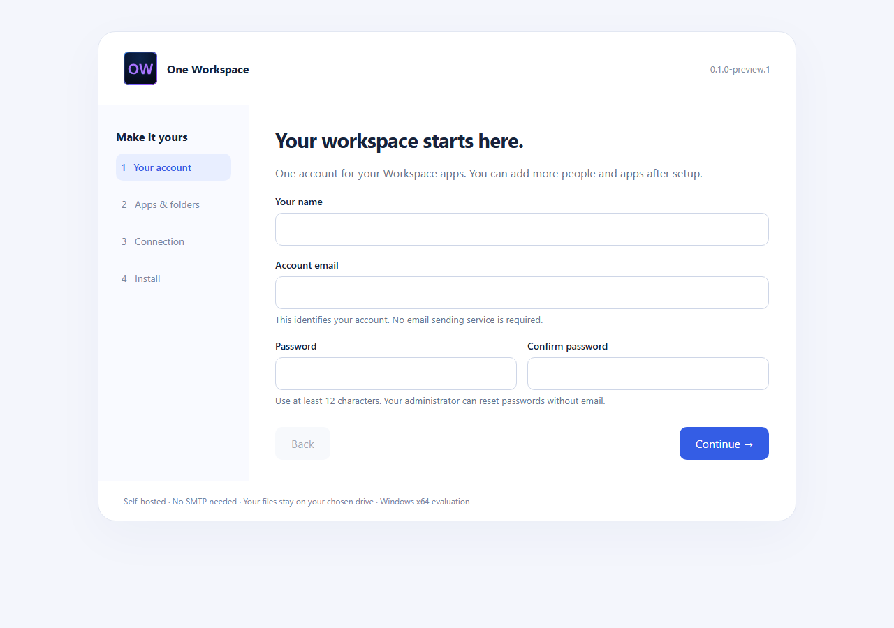
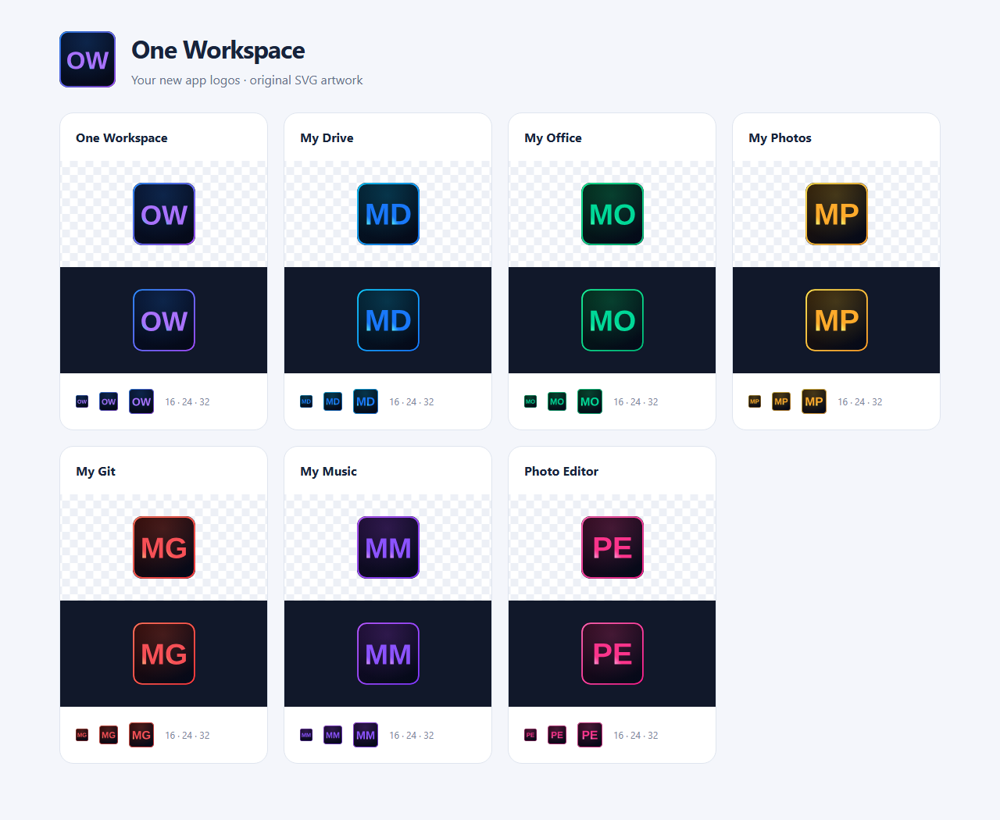

# One Workspace

One Windows installer for **MyAccounts, Drive, Docs, Photos, Git and Music**, with an app
portal and a manifest system for adding more applications later.

[Download the setup EXE](https://github.com/fahimc/one-workspace/releases) ·
[Custom FileBrowser source](https://github.com/fahimc/filebrowser/tree/drive-reskin) ·
[MyAccounts](https://github.com/fahimc/myaccounts)





## Install

1. Download `WorkspaceSetup-windows-amd64.exe` from a Workspace release.
2. Run it. The setup wizard opens in your browser on this computer.
3. Enter your name, account email and a password. **No SMTP account is required.**
4. Choose separate folders for programs, private data and your files. Programs
   and files can live on another drive; private data needs an **NTFS** volume.
5. Choose local access, your existing HTTPS proxy, or a dedicated Cloudflare Tunnel.
6. Install, launch, then open the workspace address. Allow a minute or two for the
   first start and integrity checks. Later, use **One Workspace** in the Start menu.

The EXE contains the app binaries, editor assets and optional Cloudflare connector.
Local setup does not download applications or require Go, Node.js, Office, Docker,
a mail server or a second document server. Public access needs an Internet
connection and your own domains/tunnel account. Windows x64 only; unsigned preview.
Allow at least 2 GB for setup/program files and room for your documents and history.

| Included app | What it does | Integration |
| --- | --- | --- |
| MyAccounts | Sign-in and account administration | Shared OIDC identity provider |
| Drive | Browse, upload and manage files | Custom FileBrowser with MyAccounts login |
| Docs | DOCX, XLSX, PPTX and supported PDF editing | Runs inside the Drive executable |
| Photos | Photo library and viewer | Shares Drive's permissions and authenticated APIs |
| Git | Gitea repositories and collaboration | Native MyAccounts login at `/git/` |
| Music | Standalone Swing Music player | MyAccounts login at `/music/`, shared Drive `Music` folder |

Git and Music are included in the **0.2 Git and Music preview**. The original
0.1 installer contains the first four apps. See [Git and Music setup](docs/GIT-MUSIC.md)
for standalone use, shared storage and component details.

**These are self-hosted applications, with no Google service dependency.** Files
remain ordinary files in your chosen folder. The initial `My Drive` source is a
shared folder available to new suite users; it is not an automatic private home
directory per person. Configure FileBrowser scopes/permissions before using it
with people who should have different file access.

## Accounts and administration

The wizard creates a Workspace owner in the ordinary `myaccounts` organization.
Sign in to the portal, then use **Manage accounts** to add/edit/remove users and
reset passwords. Email delivery is disabled initially; administrators can reset
passwords without email. Configure an email service separately in MyAccounts if
you want verification emails or self-service recovery.

Apps share an identity. An existing MyAccounts session is reused when opening
Drive's **Sign in with MyAccounts** link; Docs and Photos reuse Drive's session.
Each app retains its own session. Portal sign-out clears the portal session;
sign out of Drive and Accounts as well on shared computers. Immediate global
session revocation across all apps is not implemented in this preview.

## Local and public addresses

Default local addresses are `http://localhost:8990` for Workspace and
`http://localhost:8991` for Accounts. Drive is under `/drive/`, Docs opens the
Documents folder, and standalone Photos is at `/photos-app/` on Workspace.
All servers bind to loopback; changing the hostname does not expose a LAN port.

For public setup, enter two stable HTTPS addresses, such as
`https://workspace.example.com` and `https://login.example.com`. Existing proxy
mode must route them to the Workspace base port and the next port respectively,
preserving the external Host and HTTPS forwarding headers. Configure those
routes before launching the suite.

Cloudflare mode asks for account ID, zone ID and a scoped API token. It creates
one dedicated tunnel and two **new** DNS records after explicit consent in the
wizard. Existing DNS records are refused. The setup API token is not saved;
the runtime connector token is stored using Windows DPAPI in the protected data
folder. Created resource IDs are recorded in `cloudflare-resources.json` for
later administration. Cloudflare is used for HTTPS tunnelling, not email.
See [public connection setup](docs/CONNECTIONS.md).

## Add another app

Future apps have a manifest describing their package hash, launch arguments,
port, route, dependencies and optional OIDC callback. Stop Workspace, add a trusted
single-EXE app, then start it again:

```powershell
& 'F:\Workspace-Data\Workspace.exe' --data 'F:\Workspace-Data' stop
& 'F:\Workspace-Data\Workspace.exe' --data 'F:\Workspace-Data' add-app `
  --manifest 'I:\Downloads\my-app.json' --package 'I:\Downloads\MyApp.exe'
& 'F:\Workspace-Data\Workspace.exe' --data 'F:\Workspace-Data' run
```

The launcher validates the package and adds a portal tile, supervised process
and protected proxy route. OIDC-aware apps receive a dedicated client registration
and credentials through environment variables. App packages run as your Windows
user: only add apps you trust. [Manifest guide and working example](docs/ADDING-APPS.md).

## Operate and back up

Use the small `Workspace.exe` in the **private data folder** with `--data PATH`:

| Command | Result |
| --- | --- |
| `run` | Start the supervised suite |
| `open` | Open the portal in your browser |
| `status` | Show app process status |
| `apps` | List installed apps and routes |
| `stop` | Stop this suite and its child processes |
| `add-app --manifest FILE --package EXE` | Install an extension while stopped |
| `recovery` | Display the local server/Drive recovery credentials in your console |

Keep recovery credentials private. The owner's password is not stored by the
Workspace manager. Secrets use machine-bound DPAPI plus restricted Windows ACLs;
copying encrypted data to another machine is not a migration method. Back up
Accounts through its supported backup procedure, Drive's settings/history and
your file folder. Close document tabs and stop the suite before taking a full
filesystem backup. Logs rotate at 5 MiB per file under private data.

Windows sign-in startup is optional. It starts for the installing user after
they sign in; this preview is not a Windows service. To uninstall, stop the suite,
remove the `OneWorkspace` value under your HKCU `Software\Microsoft\Windows\CurrentVersion\Run`
key if enabled, and remove the Start Menu shortcut and program folder. Retain
your private-data and file folders until backed up. Remove dedicated Cloudflare
resources separately using their recorded IDs. No automatic in-place upgrade or
destructive uninstaller is supplied.

## Development and release

```powershell
go test ./...
go vet ./...
./scripts/build.ps1 -Accounts 'I:\Components\MyAccounts.exe' `
  -Drive 'I:\Components\FileBrowser.exe' -Photos 'I:\Components\Photos.exe' `
  -Cloudflared 'I:\Components\cloudflared.exe' -ComponentNotices 'I:\Components\notices'
```

The result is `dist/WorkspaceSetup-windows-amd64.exe`; SHA256 sums and the
component catalog are beside it. Component binaries stay out of Git. To rebuild
from the pinned component seed in this private repository, run
`./scripts/rebuild.ps1 -Go 'I:\Tools\Go\bin\go.exe'`. Builds and tests run locally;
GitHub Actions is disabled for this repository.

This is an **evaluation release**, not production acceptance. The current Drive
and Photos payload comes from the local Photos development build; MyAccounts is
`preview-20261014.2`. [Component provenance](docs/COMPONENTS.md) and
[verification/limitations](docs/VERIFICATION.md) distinguish tests performed here
from outstanding clean-host, service/reboot and live Cloudflare provisioning
checks. Component licenses and source distributions accompany release assets;
the bundled editor retains its upstream AGPL terms and notices.

## App logos

Current source uses your coordinated SVG logos, with matching browser, installable app and Windows executable icons. Existing published installers keep their original branding until a new release is built. See [branding and rebuild instructions](docs/BRANDING.md).
