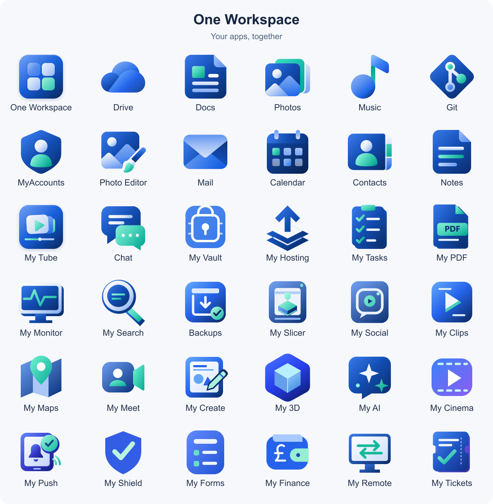

  
  <h1>One Workspace</h1>
  
Your apps and files, together on your own Windows PC.

  
<a href="https://github.com/oneworkspacestudio/one-workspace/releases"><strong>Download for Windows</strong></a> · <a href="#get-started">Get started</a> · <a href="docs/TECHNICAL.md">Technical guide</a>

*An illustrated look at the workspace. Check the download notes for the apps included in each package.*

## A place for your everyday work

Browse files, edit documents, enjoy your photos and music, and move between apps with one account. One Workspace brings them together in a browser, while your files stay on the computer and in the folders you choose.

- **Your files stay yours.** Work with ordinary folders on your own storage.
- **One account across your apps.** Sign in and open what you need from the workspace.
- **Room to grow.** Add more apps as your needs change.

## Meet your apps

*The current project logos. Open an app repository below for its source, README and downloads.*

| App | What you can do | Repository |
| --- | --- | --- |
|  **Drive** | Browse, upload, organise and share your files. | [drive](https://github.com/oneworkspacestudio/drive) |
|  **Docs** | Create and edit documents, spreadsheets, slides and PDFs. | [drive](https://github.com/oneworkspacestudio/drive) |
|  **Photos** | Browse your pictures and explore folders as albums. | [drive](https://github.com/oneworkspacestudio/drive) |
|  **Music** | Listen to your music collection. | [Music](https://github.com/oneworkspacestudio/Music) |
|  **Git** | Keep code projects organised and collaborate. | [gitea](https://github.com/oneworkspacestudio/gitea) |
|  **MyAccounts** | Manage people, sign-ins and passwords. | [myaccounts](https://github.com/oneworkspacestudio/myaccounts) |
|  **Photo Editor** | Draw and edit images and layers, opening and saving directly in Drive. A standalone Studio.exe is also installed. | [Photo-Editor](https://github.com/oneworkspacestudio/Photo-Editor) |
|  **Mail** | Your inbox, automatic MyAccounts mailboxes and guided hosting setup. | [mail](https://github.com/oneworkspacestudio/mail) |
|  **Calendar** | Events, schedules and calendars with MyAccounts sign-in. | [calendar](https://github.com/oneworkspacestudio/calendar) |
|  **Contacts** | Your address book, sharing Calendar's local service. | [calendar](https://github.com/oneworkspacestudio/calendar) |
|  **Notes** | Private notes and notebooks, with Markdown editing and history. | [notes](https://github.com/oneworkspacestudio/notes) |

The organization build includes all currently released apps above, with exact
release URLs and checksums recorded in the package. [App sources and installation](docs/ORG-APPS.md).
Notes is included from its [organization release](https://github.com/oneworkspacestudio/notes/releases).
Calendar and Contacts use a shared local service. Hosting-capable Mail keeps its
existing private engine and mailboxes until an explicit supported migration.
[Shared-service integration](docs/SHARED-SERVICES.md).

Included apps vary by download. The [release notes](https://github.com/oneworkspacestudio/one-workspace/releases) show what is available now.

## Get started

You need a **64-bit Windows PC** and at least **4 GB of free space**, plus room for your files. See the [storage requirements](docs/TECHNICAL.md#requirements-and-storage) before choosing your installation folders.

1. **Download the installer.** Open [Downloads](https://github.com/oneworkspacestudio/one-workspace/releases) and choose `WorkspaceSetup-windows-amd64.exe`.
2. **Make it yours.** Run the setup wizard and enter your name, email address and a password.
3. **Choose one folder.** Workspace organises apps, private settings and your files inside it. Choose local access or connect your domain with Cloudflare.
4. **Install the latest apps.** Setup downloads the newest published Workspace bundle from GitHub, verifies its checksums, and shows progress. Launch Workspace and sign in.

Your computer needs to stay on while you use the apps. Access through your own web address is optional; the [online setup guide](docs/TECHNICAL.md#local-and-public-addresses) explains what is needed.

Take a look at the setup wizard

> **Currently in preview.** One Workspace is still being developed. Keep backups of important files and read the download notes before installing or changing an existing workspace.

The October 15 bundle includes the updated app icons and fixes, with current
limitations recorded in the release notes. Music uses its previous published
version while Microsoft analyses a Defender detection in its newer build.
[Release status and limitations](docs/RELEASE-STATUS.md).

### Keeping new installs current

Normal installation checks the public GitHub releases each time and downloads the
newest published Workspace application bundle, including preview releases. Each
bundle declares the versions of its apps as a compatible set. An installer you
saved earlier will therefore install the latest published bundle. Unreleased Git
commits are not installed. Setup stops with a retry message if GitHub or checksum
verification fails; it does not silently install the old embedded versions.

Setup also checks [Mail's organization releases](https://github.com/oneworkspacestudio/mail/releases)
independently, and installs the newest published Mail executable with a supported
Workspace compatibility manifest. It verifies GitHub's SHA256 and size before
installation and records the exact Mail version and release source. An invalid,
unavailable or incompatible Mail release stops online installation with guidance.
Download an updated installer if a future Mail integration version is unsupported.

The complete Calendar/Contacts bundle requires installer integration2. Setup17
or earlier stops before installing this bundle and asks for the current installer.
Download the current installer once to move to this application set.

For an intentional offline installation, run
`WorkspaceSetup-windows-amd64.exe --offline`. This uses the versions bundled with
that installer. Existing installations are not automatically upgraded by this
new-install behavior. Mail hosting checks incoming SMTP connectivity separately
and shows guidance for router, Windows firewall or ISP restrictions.

## A few useful things to know

### Where are my files kept?

In the folders you choose on your own computer. They stay as ordinary files that you can access outside Workspace too.

### Can I invite other people?

Yes. Use **Manage accounts** to add people and reset passwords. The starting Drive folder is shared, so review who can access it before inviting others. [Account and sharing details](docs/TECHNICAL.md#accounts-and-administration).

### Do I need an email service?

No. You can create accounts and reset passwords without one. Email verification and password-recovery emails are optional features you can set up later.

### Can I add more apps?

Yes. Workspace can be extended with additional apps. Connecting a new app currently takes some configuration; see [adding apps](docs/TECHNICAL.md#add-another-app).

## Help and further reading

| Looking for… | Start here |
| --- | --- |
| A download or what changed | [Downloads and release notes](https://github.com/oneworkspacestudio/one-workspace/releases) |
| Setup, online access or backups | [Technical guide](docs/TECHNICAL.md) |
| A problem to report | [Report an issue](https://github.com/oneworkspacestudio/one-workspace/issues) |
| Licensing and component information | [Licenses and sources](docs/COMPONENTS.md) |
