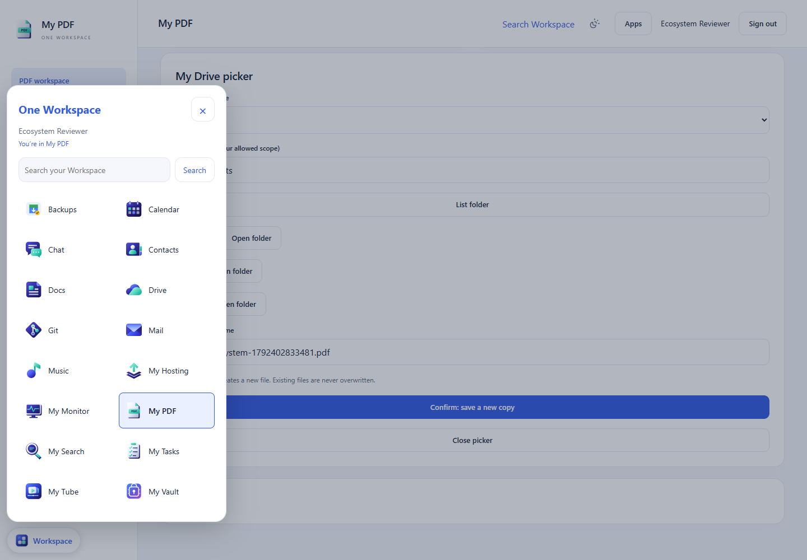

# Ecosystem review — 19 October 2026

This review uses a fresh local Windows installation, synthetic MyAccounts users,
and ordinary test files. The owner's installation, account, tunnel, DNS and files
were not changed. These fixes are included in the One Workspace preview.38 release series.
See [Releases](https://github.com/oneworkspacestudio/one-workspace/releases) for
the published Windows installer and exact component versions.

## Issues fixed

| Issue | Change |
| --- | --- |
| Different app switchers and no indication of the current app | One branded Workspace dialog with app icons, current-app selection, Search and Drive links. The newer apps and Calendar/Contacts reuse it; standalone apps retain their own controls. |
| Switcher keyboard and mobile usability | Native modal focus handling, Escape, focus return, visible focus rings, viewport bounds and a compact mobile launcher. Ctrl/Cmd+K opens Workspace search. |
| Theme preferences diverged across tabs | Tasks, PDF, Monitor, Search, Notes, Calendar and Contacts share the browser's appearance preference. Incoming preference events do not write back and cause feedback loops. The home page follows it too. |
| PDF required a separate visit to Drive | A bounded native OIDC handoff connects Drive and returns to the picker. No password or session is transferred between apps. |
| Opening a folder in the PDF picker required a second click | The picker loads its first folder and loads children immediately when opened. Import closes the picker. Save-copy preserves the original ordinary file. |
| Search reconnect lost the user's place/opened another tab | A source can connect and return to the same search in the same tab. Older managers retain their existing manual-connect fallback. |
| MyAccounts/Backups lacked stable registry IDs | All launcher entries now have stable IDs; clients do not have to infer identity from translated/display names. |
| Infrastructure tools were offered to ordinary members | My Monitor is omitted from the member launcher; its server-side owner checks remain enforced. |
| Mail setup failure appeared as JSON after sign-in | An unconfigured mailbox service gives an explanation and an owner-only protected setup action before starting OIDC. Members receive appropriate owner guidance. |
| Monitor said Mail was up although setup was incomplete | Managed health responses with `configured:false` count as incomplete readiness, even if HTTP responds successfully. |
| Re-adding omitted apps only supported the four newest apps | `install-apps --apps` accepts apps from the verified bundle and their dependencies, while retaining unrelated exclusions and existing binary/data checks. Photos was actually re-added in the fixture. |
| Contacts tab used Calendar's title/icon; several app titles differed | Contacts, Notes, Music, Photos and Photo Editor use the matching product identity, while content-specific titles and upstream legal attribution are retained. |
| A stopped app produced a bare 502 | Browser navigation gets a branded recovery page with retry/home actions. API requests keep their error status and are not replaced by an HTML success page. |

## App and storage review

Files created for sharing between apps belong in the configured **Files** tree,
accessed through Drive's authenticated APIs. Databases, session material, indexes,
mailboxes and encrypted vault state belong in protected **Private/app** folders.
Making private databases browseable in Drive would bypass the apps' permissions.

| App | Storage / integration | Remaining boundary |
| --- | --- | --- |
| MyAccounts | Identity provider; per-app OIDC sessions | Separate administration origin/UI; no portal credentials injected there. |
| Drive | Ordinary files and folder permissions | Older native theme controls are still separate from the new shared preference. |
| Docs | Office documents in Drive's existing folders | Document-type editing capabilities remain those of the bundled editor. |
| Photos | Drive photos and existing folders | No Android background uploader in this scope. |
| Photo Editor | Opens/saves images through Drive's permission-aware adapter | Editing workspace deliberately retains its canvas-focused dark layout. |
| Music | Reads the ordinary Files/Music folder | Shared library permissions do not automatically inherit each user's Drive scopes. This needs explicit product treatment before claiming a uniform private multi-user media library. |
| My Tube | App-managed media plus explicit Drive integration | Visibility and publishing rules belong to My Tube; no implicit publication of arbitrary Drive files. |
| Notes | Private notes/attachments; Markdown/HTML/JSON exports | No general Drive picker or direct save-copy yet; exports currently require upload to Drive. |
| Mail | Private mailbox/drafts/attachments | General Drive attachment/save-copy UI remains absent. Internet delivery requires actual domain/network setup and was not tested by this local-only review. |
| Calendar | Private CalDAV data and explicit links/ICS | Tasks/reminders are not a bidirectional Tasks synchronization service. |
| Contacts | Private CardDAV collections | Contact permissions are separate from ordinary file permissions. |
| Chat | Private Tinode messages and attachments | General Drive attachment/save-copy UI remains absent. |
| Git | Repository storage and native repository permissions | A repository is not an ordinary Drive folder; editing its internal database from Drive is unsafe. |
| My Hosting | Private projects/builds and versioned published deployments | Deployment and public-site visibility remain explicit actions. |
| My Vault | Independently encrypted vault and recovery data | Unique HTTPS certificate trust/enrollment and master-password unlock remain required where applicable. No secrets enter Search or Drive. |
| My Tasks | Private/shared task lists; explicit Notes/Calendar links | No bidirectional Calendar task sync or general Drive attachment picker. |
| My PDF | Private working copies; explicit Drive import/save-copy | Saving creates a new file; originals are not silently overwritten. |
| My Monitor | Private owner-only status/incident history | A healthy listener does not certify Internet mail delivery, backups or every app workflow. |
| My Search | Live queries using each user's source session | Mail bodies and Chat messages are not searched; Vault is excluded. |
| Backups (internal) | Optional whole-installation backups | Off by default; protected NTFS destination and documented pause/restart behavior. |

## Design contract



- Use the supplied app logo and its catalog name consistently in title, favicon,
  launcher and app header. Keep upstream attribution in appropriate About/legal UI.
- Shared chrome uses Segoe UI/system typography, navy text, blue primary actions,
  pale surfaces, rounded cards and visible keyboard focus. Dark surfaces maintain
  the same hierarchy. Tool-specific layouts remain appropriate for each job.
- Managed app navigation uses the catalog, not hard-coded lists of installed apps.
  Optional apps must not create dead links; owner controls are not offered to members.
- Reuse verified native sign-in. Distinguish account sign-in, Vault unlock,
  unfinished setup, unavailable services and denied access.
- Cross-app file actions use the current user's Drive permissions, explicit
  destinations and clear save-copy/overwrite semantics. No administrator crawler
  or foreign database reads substitute for authorization.

## Verification and limits

The reproducible browser regression is `scripts/ecosystem-e2e.mjs`. It requires an
isolated full 19-app installation on `http://localhost:29xxx`, the synthetic owner
`tester@example.test`, and these environment variables:

```
WORKSPACE_E2E_ORIGIN
APP_E2E_PASSWORD
WORKSPACE_E2E_NODE_PACKAGE
WORKSPACE_PDF_PACKAGE
APP_E2E_OUTPUT
```

The two package paths point to the Search and PDF `web` directories with local
dependencies installed. The test refuses other origins and does not save browser
credentials. Build locally; GitHub Actions is not used.

Native Windows builds, generated AUI/TypeScript builds, targeted Go regressions,
frontend contracts and synthetic browser flows were exercised. Whole-app opening
and visual review is not certification of every editor, media format, mail route,
reboot/service transition, independent security audit or clean physical host.
Older native apps still have some separate theme/settings conventions. The missing
Drive pickers and synchronization features above remain genuine product gaps.

### Recorded results

- All 19 app entries plus Backups opened in the full isolated installation. No
  page-level horizontal overflow was detected at 1440px. Music reached its player;
  Mail showed setup guidance; Vault showed its certificate/trust handoff. Those
  last two are not mailbox-delivery or vault-unlock acceptance.
- Twelve managed browser regressions passed: single sign-in, automatic PDF/Drive
  connection, folder navigation, byte-preserving Drive copy, accessible shared
  navigation, cross-tab appearance, mobile bounds, protected Mail setup, all app
  IDs/Photos restoration, Monitor readiness, Search reconnect and themed home.
- Targeted Go regressions passed for connection destinations/session binding,
  recovery errors, app visibility, incomplete Mail setup, native sign-in and
  arbitrary verified app reinstallation. Monitor readiness's unit test passed.
- Nineteen frontend contract/filter/security tests passed across the four newer
  apps. All seven changed native Windows executables and the manager compiled;
  Calendar and Contacts share the same rebuilt frontend.
- No production account, live-installation test data, tunnel/DNS change, external
  mail delivery, Vault decryption or GitHub Actions was used for these checks.

### Release verification

[Workspace preview.38](https://github.com/oneworkspacestudio/one-workspace/releases/tag/v0.3.0-preview.38)
was built locally and published with the six updated component releases. All91
bundle members passed size/SHA256 verification, and all21 Workspace assets matched
their GitHub digests. Public component ZIP downloads were independently hashed.

A fresh offline installation of this exact installer selected all19 apps and passed
all12 managed browser regressions. The first attempt reached Monitor before its
initial discovery had settled; the test now waits for the discovered check before
running it. No runtime payload change was needed. The fixture was stopped and
removed, reclaiming approximately741MB on C:. The owner's installation was not
updated by these release checks. Existing product and acceptance limits remain.
