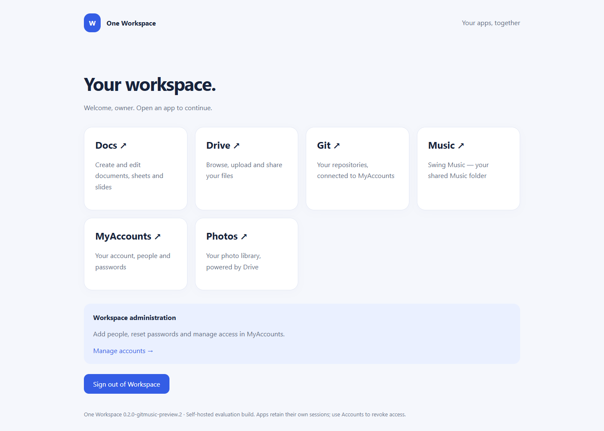
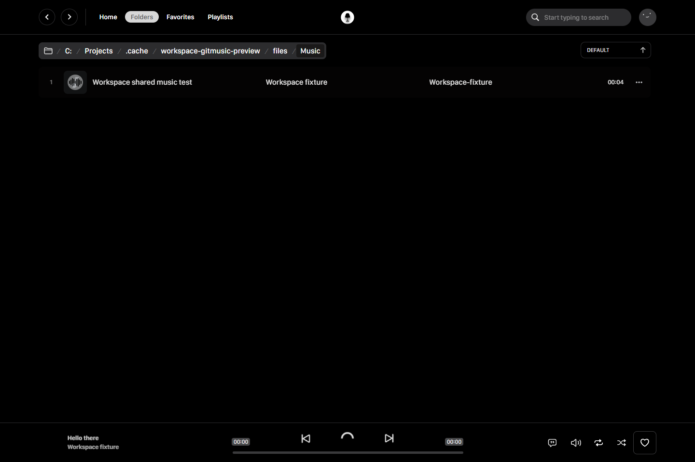

# Git and Music edition

[Download the Git and Music installer](https://github.com/fahimc/one-workspace/releases/tag/v0.2.0-gitmusic-preview.2).

The extended installer includes the independent [Gitea fork](https://github.com/fahimc/gitea)
and [Swing Music fork](https://github.com/fahimc/swingmusic). Each is a supervised
native process with its own MyAccounts client. Both are served by the Workspace
gateway on its existing address, including through the optional Cloudflare
tunnel; no additional public hostname or DNS record is needed.

| App | Workspace address | Data |
| --- | --- | --- |
| Git | `/git/` | Private `gitea` folder: SQLite, repositories, configuration, DPAPI recovery |
| Music | `/music/` | Private `music` folder: accounts, indexes, playlists and images |
| Music files in Drive | `/drive/files/My%20Drive/Music` | Ordinary `Music` folder inside the selected files directory |

The base port plus 4 and 5 are reserved for Gitea and Music. The apps bind only
to loopback. The proxy strips their public prefixes and leaves authentication
to each app. This permits Gitea's HTTP Git clients/access tokens and each app's
own OIDC callbacks without a portal-cookie challenge interrupting them.

Setup registers exact `/git/user/oauth2/myaccounts/callback` and
`/music/auth/myaccounts/callback` URLs. Client secrets are in Workspace's DPAPI
state and child environments, never app manifests or command lines. Gitea also
stores its client secret in its protected authentication database, as native
Gitea requires. Both use stable provider subjects rather than email auto-linking.
The music administrator is the exact configured Workspace owner; other new
music/Gitea users receive ordinary roles. Gitea retains a separate random local
recovery administrator, machine DPAPI protected at `gitea/recovery.dpapi`.

Music runs independently and can also be launched outside Workspace; see the
fork's [standalone instructions](https://github.com/fahimc/swingmusic/blob/master/WORKSPACE.md).
Without MyAccounts environment variables it retains local-password standalone
mode. With MyAccounts it disables local/guest account creation and pairing.
Uploads and changes in Drive's Music folder are rescanned about every 15 seconds.
Tracks are not copied into a database or a second media directory. All permitted
music users share the library; changing FileBrowser scopes does not impose matching
per-track Music permissions. Playlists and listening data remain user-specific.

Build both fork packages first. Pass their `Gitea.exe` and `Music.exe` to
`scripts/build.ps1 -Gitea PATH -Music PATH` alongside the existing Accounts,
Drive, Photos and connector inputs. Omitting both produces the original base
edition; providing only one is refused. Build to a separate staging directory
when another release is in progress. This preview does not migrate an already
installed suite or silently adopt an existing Gitea database.

Gitea packaging embeds the unmodified, verified official 28.1.0 binary plus
MinGit 2.56.0.2 and a source-available provisioning launcher. Swing Music is built
from its fork with the pinned v3.0.0 webclient adapter, Authlib, Waitress and
FFmpeg. Component licenses and source locations accompany the extended payload.
The installer and applications remain unsigned evaluation builds. Existing
Office, Photos, cloud and clean-host acceptance limits continue to apply.

## Verified preview

Verified real browser MyAccounts callbacks for portal, Drive, Music and Gitea;
normal-user Drive upload to the Music folder; automatic MP3 indexing; identical
streamed bytes; actual player range requests and browser playback; ordinary Gitea
roles; anonymous media/API denial. Signed OIDC fixture rejects wrong-client tokens
and bad state. All Workspace Go tests pass. Fresh installation and restart use
isolated directories; existing live apps are preserved. No new production tunnel,
DNS change, clean-host Windows or reboot acceptance is claimed.

