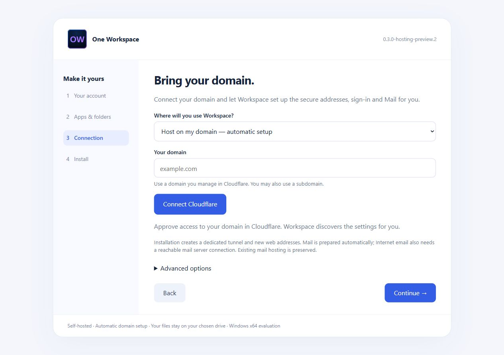
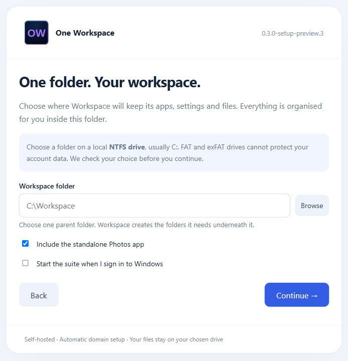
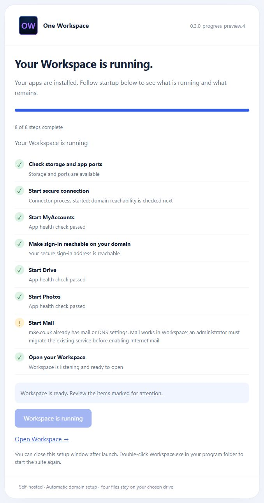

# Automatic domain hosting

This guide describes the local hosting development preview. Its implementation
and installer updates have not been published with this documentation update;
existing GitHub release assets retain their previous setup flow.

## Normal setup

1. Create the Workspace owner (passwords start at 8 characters) and choose one
   Workspace parent folder on a local NTFS drive. Its compatibility is checked
   immediately, before continuing.
2. Select **Host on my domain**, enter a domain managed by Cloudflare, then click
   **Connect Cloudflare**. Approve the official Cloudflare browser authorization
   when prompted. A matching existing connector login can be reused.
3. Install and launch Workspace. Open Mail to see its hosting progress.

The installer discovers the account/zone and selects unused first-level web
addresses. Root domains use `workspace.example.com` and `accounts.example.com`.
Subdomains use an installation-domain hash in those labels to remain within the
zone's standard wildcard TLS coverage. If a web address is occupied, another is
chosen. The chosen addresses are shown before installation.

It creates a dedicated Cloudflare tunnel, its two web DNS records, MyAccounts,
the owner, application clients and exact callbacks. Mail receives the chosen
email domain and protected credentials directly. It bootstraps Stalwart, enables
the MyAccounts directory, and exposes its SMTP listener on IPv4 TCP 25.

Mail discovers public IPv4 through HTTPS at `api4.ipify.org`, creates a DNS-only
`smtp.<domain>` A record, MX, initial SPF and monitoring DMARC. It enables
Stalwart's background DKIM generation/publication and DNS-01 ACME issuance and
renewal. DKIM selectors have an installation-specific prefix. Certificate and
key completion are not inferred from a successful configuration request.

Existing mail DNS blocks automatic takeover. Only records whose IDs were saved
by this installation can be reused on retry; edited records or IP changes need
review. Failed operations may leave the recorded subset created so far. Retry
continues from those receipts; unknown outcomes require provider inspection.



*Local installer screen; this capture does not represent a completed public deployment.*

## What a domain cannot authorize

Cloudflare authorization grants access to DNS and the web tunnel. It cannot
grant access to the router, Windows firewall, an ISP's SMTP policy or a server
provider's reverse DNS settings. This build does not provision those, a VPS,
mail gateway or a delivery-provider account. It does not perform an external
mail-delivery acceptance check. These remain deployment requirements:

- Incoming TCP 25 must reach the Windows host. HTTP tunnelling does not carry
  normal SMTP.
- The network must allow outgoing SMTP, or an authenticated relay is required.
- Public IP/reverse DNS must suit the mail server; address changes need review.
- Certificates and DKIM background tasks must complete before delivery use.

The UI distinguishes Mail being configured from Internet delivery being ready.
Advanced settings are available for migration, custom hosting and relay setup.
MyAccounts verification/reset email sending remains a separate opt-in setting.

## Credentials and operation

The official `cloudflared tunnel login` uses its normal `~/.cloudflared/cert.pem`.
An existing certificate is not overwritten. If it belongs to another domain,
use the advanced scoped-token connection instead. The connector is extracted
from the verified installer payload for the login step; no separate CLI install
is required.

The installer retains connection credentials in server memory; browser state
contains only the selected domain/addresses and progress. The installed suite
keeps its connector token and Mail DNS credential under NTFS ACLs and Windows
machine DPAPI. Mail needs the DNS credential during renewal. Native applications
run as the installing Windows user. Stop and back up the suite before moving
data; machine-bound encrypted credentials need reconfiguration on another PC.

One setup EXE includes the runtime components. Running the suite does not require
Docker or a development runtime. Automatic hosting applies to fresh domain-mode
installations; it does not migrate existing mailbox domains or replace a running
installation. Local/manual modes retain advanced Mail setup.


## Storage layout

The current installer asks for a single parent folder and creates `Apps`,
`Private` and `Files` beneath it. The folder picker opens in front of the setup
window and starts at the current choice when possible. The storage step explains
the NTFS requirement before selection, validates the actual volume after selection
or a typed-path change, and blocks Continue on an incompatible location. The
server repeats the read-only check before accepting installation and before any
folder creation. Incompatible storage errors name the drive/format and suggest
a local NTFS drive instead of displaying internal Windows flags.

Legacy headless requests can still provide separate `programs`, `data` and `files`
paths. New requests use `folder`; the server derives the three internal paths.
Existing private state is never reused by a fresh installation. Selecting a new
parent does not migrate an existing suite.




## Installation and startup progress

The progress build shows a checklist, completed-step bar, elapsed time and the
latest observed health result. Installing files and starting apps are separate
phases. The Open Workspace link is available only when the portal is ready.
App exit or a timeout produces a retained failed step and Retry startup instead
of an indefinitely disabled Starting button. Public sign-in gets up to five
minutes for DNS/HTTPS/tunnel readiness, with ongoing status during that wait.

Startup snapshots are saved in the protected `Private/startup-progress.json`.
The UI also checks that its recorded launcher process is still running at this
installation's path. The bar measures completed checks, not a time estimate.
Mail's Internet-hosting issues are displayed as warnings; they do not falsely
mark the whole Workspace as stopped or imply Internet email is configured.

To reopen progress for an installed suite without reinstalling it:

```powershell
./WorkspaceSetup-progress-preview.exe --resume C:/YourWorkspace/Private
```

The owner-only local setup link is opened in the browser. Startup failure
details also remain in `Private/launcher.log` and the component logs. Keep these
private. Resume does not change the owner, files, domain or app registrations.


