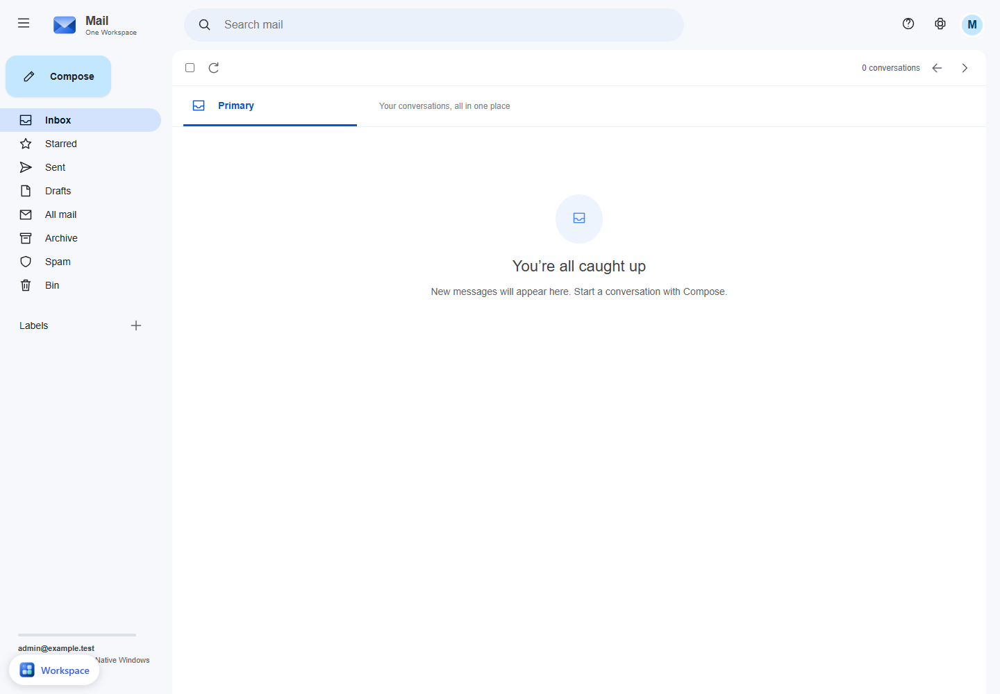

# Mail (Stalwart)

[One Workspace Mail source](https://github.com/oneworkspacestudio/mail/tree/main/workspace-mail)
adds a Gmail-style native Windows client and a pinned Stalwart 0.16.26 engine.
It can also run standalone. See that project's README and notices for the mail
setup wizard, licensing, portable runtime and current preview limits.

Automatic domain hosting is included in the public preview release. Online setup
independently verifies the current Mail release in the organization repository.

## Add to an existing installation

Build Mail.exe locally in the fork, then use this repository's current manager:

```powershell
./scripts/mail-manifest.ps1 -Exe C:/Downloads/Mail.exe -Version 0.1.0-preview.15 -Port 8996 -Output C:/Downloads/mail.json
./Workspace.exe --data C:/WorkspacePrivate stop
./Workspace.exe --data C:/WorkspacePrivate add-app --manifest C:/Downloads/mail.json --package C:/Downloads/Mail.exe
./Workspace.exe --data C:/WorkspacePrivate run
```

Choose three unused consecutive ports. The first is the web app, followed by
the private Stalwart HTTP and local SMTP ports. App packages are trusted native
executables running with the installing user's rights. The manifest records
the exact package hash; the manager holds it against modification while running.

The Mail tile is generated from the catalog. `/mail` is routed through the
authenticated Workspace portal; Mail also verifies its own MyAccounts session.
Its dedicated OIDC client has the exact `/mail/auth/callback` callback. Owner
privileges use the Workspace owner's stable subject, never a contact email.
Private state is `${DATA}/mail` with NTFS ACLs and DPAPI credentials.

## Include in a new installer

Pass `-Mail C:/Build/Mail.exe` to `scripts/build.ps1` along with the existing
Accounts, Drive, Photos and Cloudflared arguments. Git/Music may still be included
using their existing optional arguments. Build locally; do not use Actions.

The installer assigns Mail base port +6, engine +7 and SMTP +8 and registers
the client automatically. With **Host on my domain**, it also supplies the
mail domain and protected DNS connection: Mail configures itself on first launch.
The owner sees hosting progress and any blocker, then signs in. Local and advanced
installations retain the manual wizard. The suite manager reserves the internal
ports before startup. Use `-MailVersion` to identify the bundled Mail build.

## Domain and delivery

See [Automatic hosting](HOSTING.md) for the domain-first path and remaining
SMTP network requirements. The form-based instructions below are advanced
options for existing installations; this change does not migrate their domains.


The wizard accepts a webmail hostname, email domain, Cloudflare Zone ID and
request-only DNS token, with a review step before record creation. Existing
records are never replaced. It can configure an authenticated TLS outgoing
relay without sending a message. Normal Internet receiving requires public SMTP,
TLS, DKIM, MX, SPF/DMARC and reverse DNS; HTTP tunnelling does not provide SMTP.
Public-domain settings must be completed by the installation owner.

This is an evaluation integration. Inbox/compose/search/labels/drafts/attachments
are implemented; it does not claim all Gmail behavior. Do not test against the
live MyAccounts or FileBrowser installations. Use fresh private NTFS state.

## Browser identity and reputation

Mail15 uses One Workspace's own identity and names the MyAccounts server on the
sign-in page. A Chrome Safe Browsing warning needs investigation and Google's
review process; SMTP delivery alone cannot clear a website classification.
See [Mail browser-warning recovery](https://github.com/oneworkspacestudio/mail/blob/main/workspace-mail/RECOVERY.md).
Keep browser protections enabled. Online setup resolves the newest compatible
organization Mail release; deliberate offline16 retains bundled13.


## Automatic account setup

Workspace60 pins Mail17. Fresh setup lets the engine create its standard user
permissions after explicit installation listeners are saved, then connects
MyAccounts. Users do not edit roles. Interrupted setup reuses existing listener
IDs without attempting to change their read-only names. Existing custom access
settings and mailbox assignments are preserved.

Mail startup warnings show a plain next step. Use Reconnect Mail in Mail setup
for a connection problem. Technical diagnostics remain in protected Mail logs
and Workspace logs/mail-setup.log. Incoming Internet delivery remains separate
from mailbox sign-in and can still need network or existing-provider decisions.


## Setup repair verification

The original missing-role failure was reproduced in a fresh Workspace59 fixture.
The protected update to60/Mail17 resumed its setup and opened an empty inbox through
real MyAccounts sign-in. Mail17 is unchanged in61;61 additionally simplifies the
startup connection-check wording. The native test sent no external messages and
used no owner data. Delivery and source receipts are in
[the verification record](evidence/mail-setup-deployment-20261021.json).




## Automatic domain selection (Mail 18)

Workspace 74 includes Mail 18 in both the full installer and updates. Managed
setup reuses compatible DNS unchanged. If the requested domain has another mail
route, an unpublished installation chooses an unused subdomain automatically.
Existing published domains remain unchanged. An occupied candidate belonging to
another installation is skipped, even if it has the same public IP.

Mail setup offers Finish automatic setup, Open Mail and expandable DNS details.
Journalled domain changes preserve native mailbox IDs, folders and readable
address assignments. Internet delivery still requires SMTP reachability, TLS,
signing and suitable reverse DNS; DNS publication alone does not prove delivery.


## Incoming connection recovery (Mail 20)

The public update channel and online installer resolve Mail 20. Advanced settings
and connection details remain open during checks; late status responses cannot
replace the custom settings form. Repair connection retries the network without
rerunning DNS/account setup. Known router rules can be repaired automatically;
missing outer rules require a verified downstream destination.

If another PC already receives incoming mail through this public address, choose
one shared receiver or deliberately migrate the route. Subdomains cannot split a
single public SMTP port between independent PCs. The existing receiver stays
protected. Mail shows that blocker and next check rather than claiming delivery.


## One main Mail service across PCs (Mail 22)

Choose **Use an existing Mail service** in Mail settings on another PC. Setup
checks an optional zone TXT service pointer, then the standard main Workspace
hostname, and offers a reachable Mail service before creating new local mailboxes.
For custom or offline main servers the owner enters its HTTPS address in the app.
The app remembers the connection, checks availability when opening Mail, and
shows an unavailable main server with automatic retry rather than hiding it.

The main PC receives and stores email; other PCs open that same Mail service and
use accounts from its MyAccounts installation. There is no fixed client-PC limit;
capacity depends on the main server. Separate issuers/accounts are not merged.
This PC's private Mail engine and incoming-router checks stop after connecting.
Local messages/settings are kept, not moved; /mail/setup retains owner controls
and can resume the separate server. Main receiver routes are never replaced.
This is shared service access, not replicated mailbox stores or an SMTP gateway.


Mail22 also handles existing Workspace sign-in gates without bypassing them:
when anonymous Mail metadata is protected, its exact authentication response and
public Workspace health confirm only that Mail is running. Mailbox setup and
message delivery are not inferred. New shared clients report readiness without a
local mailbox; forwarding chains do not automatically redirect indefinitely.


Workspace76 recognises shared Mail clients in its startup, mailbox provisioning
and app launcher. It skips local mailbox creation and the extra local Mail OIDC
flow, and tells owners to add people on the main Workspace. Mail22 checks that
main service when opening. Existing local messages are never silently migrated.


Mail23 improves the upstream-router permission state: a router refusing automatic
discovery now gets the existing owner-only router-settings action and a clear
permission explanation. This is a real network prerequisite on the main receiving
PC. Joining PCs reuse the main service and do not need separate incoming rules.
The public online installer/update channel resolves23; the immutable76 evaluation
bundle contains Mail22, with the shared-role functionality and prior settings fix.
